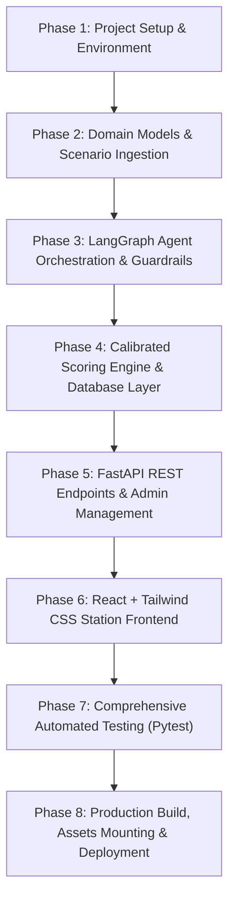

# PromptRelay V2: Multi-Agent Prompt Engineering Hotseat Competition

> A sequential 3-player hotseat competition where teams engineer prompts across a LangGraph multi-agent pipeline to solve complex visual and textual crises. Built with **React + Tailwind CSS** on the frontend and **Python FastAPI + LangGraph + SQLite** on the backend.

---

## 1. Executive Summary & Game Philosophy

**PromptRelay** transforms prompt engineering from an isolated text prompt into a competitive, high-stakes team relay. Three human players share a single laptop hotseat station, taking sequential turns to guide specialized AI agents:

```
+----------------------------------------------------------------------------------------------------+
|                                    PROMPT RELAY HOTSEAT PIPELINE                                   |
|                                                                                                    |
|  [Evidence Feeds: CCTV/Dossier]                                                                    |
|             |                                                                                      |
|             v                                                                                      |
|   +--------------------+       +------------------------+       +------------------------------+   |
|   |  Player 1 (Human)  |       |    Player 2 (Human)    |       |       Player 3 (Human)       |   |
|   | Evidence Extractor |       | Timeline Reconstructor |       |         Logic Solver         |   |
|   +--------------------+       +------------------------+       +------------------------------+   |
|             |                             |                                    |                   |
|             v (User Prompt 1)             v (User Prompt 2)                    v (User Prompt 3)   |
|   +--------------------+       +------------------------+       +------------------------------+   |
|   |      Agent 1       | ----> |        Agent 2         | ----> |           Agent 3            |   |
|   | Forensic Extractor |       |  Timeline Synthesizer  |       |     Deductive Prosecutor     |   |
|   +--------------------+       +------------------------+       +------------------------------+   |
|             |                             |                                    |                   |
|      (Extracted Facts)             (Event Timeline)                   (Structured JSON Verdict)    |
|             |                             |                                    |                   |
|             +-----------------------------+------------------------------------+                   |
|                                           |                                                        |
|                                           v                                                        |
|                       +---------------------------------------+                                    |
|                       |   Calibrated Hybrid Scoring Engine    |                                    |
|                       |  Prompt Engineering Rubric (60 pts)   |                                    |
|                       |     Final Solution Accuracy (40 pts)  |                                    |
|                       +---------------------------------------+                                    |
|                                           |                                                        |
|                                           v                                                        |
|                       +---------------------------------------+                                    |
|                       |   Official Match Report & Leaderboard |                                    |
|                       +---------------------------------------+                                    |
+----------------------------------------------------------------------------------------------------+
```

### Strict Information Hiding (Hotseat Separation)
1. **Player 1 (Evidence Extractor)**: Sees raw multi-modal evidence (CCTV feeds, airport flight monitors, witness statements, or murder dossiers). Player 1 prompts **Agent 1** to extract facts and filter noise.
2. **Player 2 (Timeline Reconstructor)**: **NEVER** sees the original evidence feeds. Player 2 only inspects **Agent 1's extracted output** and prompts **Agent 2** to reconstruct a chronological event sequence with causal dependencies.
3. **Player 3 (Logic Solver)**: Sees **Agent 2's reconstructed timeline** along with governing **Operational Rules / Policies** (e.g., `SEC-101`, `OPS-204`). Player 3 prompts **Agent 3** to deduce the culprit, method, and broken rule into a strict JSON schema.
4. **Calibrated Evaluator**: Automatically scores prompt quality (20 pts per player = 60 pts) + final case accuracy (40 pts) = 100 pts total.

---

## 2. Technology Stack & Key Architectural Decisions

| Layer | Technology | Rationale |
| :--- | :--- | :--- |
| **Frontend Framework** | **React 18 (Vite SPA)** | Fast hot-module reloading, strict component hierarchy, production-grade minification. |
| **Styling & UI** | **Tailwind CSS + Lucide Icons** | High-tech cyber/investigative dark mode, responsive layout, seamless visual feedback. |
| **Frontend State** | **Zustand** | Lightweight global store tracking active session, step transitions, and lightbox state. |
| **Backend API** | **FastAPI (Python 3.12/3.14)** | Async high-performance REST API, automatic OpenAPI / Swagger documentation. |
| **Agent Orchestration** | **LangGraph (`StateGraph`)** | Stateful multi-agent graph with linear transitions (`START -> node_extractor -> node_reconstructor -> node_solver -> node_evaluator -> END`). |
| **LLM Provider** | **Google Gemini (`gemini-3.8-flash`)** | High speed, large reasoning context, official current model recommendation with offline mock fallback. |
| **Image Evidence Ledger** | **Pre-Compiled High-Fidelity OCR/Vision Ledgers** | Solves quota limits: feeds dense visual observations into Gemini without re-uploading 10 raw image buffers per call, staying under free tier RPM limits. |
| **Persistence & State Recovery**| **SQLite (WAL Mode) + `localStorage`** | Atomic match persistence, in-progress session recovery across browser reloads, exportable to CSV/JSON. |

---

## 3. Comprehensive Phases of Implementation



### Phase 1: Environment Setup & Core Dependencies
- Initialize unified directory structure (`backend/`, `frontend/`, `scenarios/`, `image_data/`, `data/`, `tests/`).
- Configure Python virtual environment via `uv` with `pyproject.toml` (FastAPI, Uvicorn, LangGraph, LangChain, Google GenAI, Pydantic v2, Pytest).
- Configure Node.js / Vite build pipeline (`package.json`, `tailwindcss`, `postcss`, `lucide-react`, `zustand`).
- Setup configuration module (`backend/app/core/config.py`) reading `.env` (Gemini API key, default model `gemini-3.8-flash`, SQLite path).

### Phase 2: Domain Data Models & Scenario Ingestion
- Implement Pydantic domain models (`Scenario`, `ScenarioType`, `EvidenceItem`, `GroundTruth`, `GameSession`, `EvaluationReport`).
- Build rich multi-modal scenarios in `backend/scenarios/`:
  - `scenario_01_airport_crisis.json`: Image-based scenario with 10 evidence items (CCTV check-in, gate B07, flight displays, baggage tags, security maps) and high-fidelity OCR ledgers.
  - `scenario_02_blackwood_manor.json`: Victorian poisoning text mystery with forensic autopsy, alibis, and library notes.
  - `scenario_03_neon_nexus.json`: Cyber-physical IoT insulin attack scenario.
  - `scenario_04_velvet_vault.json`: Parisian gallery neurotoxin gem heist.
- Implement singleton `ScenarioLoader` with thread-safe caching and ground-truth stripping for user-facing endpoints.

### Phase 3: LangGraph Multi-Agent Orchestration & Guardrails
- Define `RelayState` typed state passing extracted facts, timeline, verdicts, and prompts.
- Implement specialized system prompts and node functions:
  - `node_extractor` (Agent 1): Filters evidence based on P1's directives; scrubs premature accusations.
  - `node_reconstructor` (Agent 2): Orders events chronologically based on P2's directives; sanitizes suspect naming leaks.
  - `node_solver` (Agent 3): Deductive logic agent mapping timeline against rules into strict JSON.
  - `node_evaluator`: Calculates scorecard results.
- Implement LangGraph `create_relay_workflow` compiling sequential `StateGraph`.
- Implement robust offline fallback (`MockOfflineChatModel`) and provider switcher.

### Phase 4: Hybrid Calibrated Scoring Engine & Database Layer
- Implement `classify_prompt_quality` scoring rubric (0-12 pts for prompt engineering + 0-8 pts for agent execution = 20 pts per player).
- Implement `parse_json_verdict` with multi-tier extraction (direct JSON, markdown code fence, regex brace extraction, heuristic aliases).
- Implement semantic overlap accuracy scoring (40 pts: Culprit 10 pts, Method 10 pts, Motive 10 pts, Rule 10 pts).
- Implement SQLite persistence with WAL mode in `backend/app/services/database.py`:
  - `matches` table: Finished games, scores, JSON dumps, timestamps.
  - `active_sessions` table: Live sessions enabling seamless refresh recovery.
  - Analytics and CSV/JSON export utilities.

### Phase 5: FastAPI REST Endpoints & Admin Management API
- Game lifecycle router (`backend/app/api/game.py`):
  - `GET /api/game/scenarios`: List all scenarios.
  - `GET /api/game/scenarios/{id}`: Detailed scenario data (secrets stripped).
  - `POST /api/game/start`: Initialize match session.
  - `GET /api/game/session/{id}`: Recover active session state.
  - `POST /api/game/step1`: Player 1 submit -> Agent 1 execution.
  - `POST /api/game/step2`: Player 2 submit -> Agent 2 execution.
  - `POST /api/game/step3`: Player 3 submit -> Agent 3 execution + full evaluation.
  - `GET /api/game/leaderboard`: Global rankings and medal standings.
- Admin management router (`backend/app/api/admin.py`):
  - `GET /api/admin/stats`: Aggregate tournament metrics.
  - `GET /api/admin/matches`: Inspector for all past games.
  - `GET /api/admin/export/csv`: Download official CSV report.
  - `GET /api/admin/export/json`: Download full JSON matches export.
  - `GET /api/admin/llm/status` & `POST /api/admin/llm/configure`: Runtime LLM settings & ping test.
  - `POST /api/admin/reset`: Database wipe for fresh tournament rounds.

### Phase 6: Modern React SPA Hotseat Station Frontend
- Design modular UI components:
  - `Header.jsx`: Tournament station banner, team indicator, leaderboard and admin triggers.
  - `EvidenceViewer.jsx`: CCTV camera feed carousel, category tabs, high-res zoom, OCR ledger viewer, text dossier reader.
  - `LightboxModal.jsx`: Fullscreen darkroom image inspection with keyboard arrow navigation.
  - `HandoffModal.jsx`: Clean hotseat inter-turn transition modal ("Hand laptop to Player 2 / 3").
  - `LeaderboardModal.jsx`: Real-time tournament ranking table with grade badges (S, A, B, C, D).
  - `AdminModal.jsx`: Comprehensive organizer control center with live LLM ping, match inspector, and CSV export.
- Implement turn screens:
  - `WelcomeScreen.jsx`: Team registration + scenario gallery card selection.
  - `Step1Screen.jsx`: Player 1 workspace (EvidenceViewer + prompt drafting + template injection).
  - `Step2Screen.jsx`: Player 2 workspace (Incoming Agent 1 intelligence feed + timeline prompt drafting).
  - `Step3Screen.jsx`: Player 3 workspace (Agent 2 timeline + operational rules + JSON schema guide).
  - `ResultsScreen.jsx`: Official match scorecard, grade badge, solution verification, and full relay chain breakdown.

### Phase 7: Comprehensive Automated Testing (Pytest)
- Write and run unit, integration, and regression test suites in `tests/`:
  - `test_cases.py`: Scenario loading and schema validation.
  - `test_graph.py`: LangGraph execution, guardrail filtering, node isolation, and evaluator scoring.
  - `test_tools_and_distribution.py`: Calibrated score distribution across prompt quality tiers.
  - `test_api_game.py`: FastAPI endpoints and full wizard progression.
  - `test_leaderboard.py`: Ranking, tie-breaking, and SQLite database persistence.
  - `test_admin.py`: Stats calculations, CSV/JSON export, match deletion, and resets.

### Phase 8: Production Build, Assets Mounting & Deployment
- Execute Vite production build (`npm run build`) outputting minified bundle to `frontend/dist/`.
- Mount `/assets` and catch-all single-page-app router in FastAPI `main.py`.
- Mount `/image_data` static directory for local evidence image serving.
- Verify end-to-end match execution with zero warnings.

---

## 4. Scoring Rubric (100 Points Total)

| Criterion | Max Pts | Evaluated Factors |
| :--- | :---: | :--- |
| **Player 1 Prompt Quality** | 12 | Persona/role (3), entity taxonomy (3), fact discrimination (3), noise constraints (3) |
| **Agent 1 Execution** | 8 | Completeness of extracted facts, timestamp fidelity, lack of premature conclusion |
| **Player 2 Prompt Quality** | 12 | Persona/role (3), chronological sequencing (3), connection tracking (3), neutrality (3) |
| **Agent 2 Execution** | 8 | Chronological coherence, causal links, lack of premature accusation |
| **Player 3 Prompt Quality** | 12 | Persona/role (3), rule analysis (3), operational deduction (3), JSON schema enforcement (3) |
| **Agent 3 Execution** | 8 | Strict JSON compliance, non-empty decision attributes |
| **Case Solution Accuracy** | 40 | Culprit identification (10), method/mechanism (10), motive (10), broken rule (10) |
| **Total Possible** | **100** | **Grade: S (90+), A (75-89), B (60-74), C (40-59), D (<40)** |

---

## 5. Getting Started & Operations

### Prerequisites
- Python 3.12+ (or `uv` package manager)
- Node.js 18+ and `npm`
- Google Gemini API Key in `.env` (`GEMINI_API_KEY=your_key_here`)

### Backend Setup
```bash
cd PromptRelay_v2
uv venv
source .venv/bin/activate
uv pip install -e .
uv run uvicorn backend.app.main:app --reload --port 8000
```

### Frontend Setup (Development)
```bash
cd PromptRelay_v2/frontend
npm install
npm run dev
# Vite runs at http://localhost:5173 (proxies /api to :8000)
```

### Production Build & Single Server Run
```bash
cd PromptRelay_v2/frontend
npm run build
cd ..
uv run uvicorn backend.app.main:app --host 0.0.0.0 --port 8000
# Entire SPA and API served together at http://localhost:8000
```

---

## 6. 3-Laptop Wi-Fi LAN Multiplayer Setup (Zero Cloud Hosting)

PromptRelay V2 supports synchronized 3-laptop multiplayer over the same local Wi-Fi network without requiring public hosting or cloud servers.

### How to Run on 3 Laptops:
1. **Connect all 3 laptops to the same Wi-Fi router / mobile hotspot.**
2. **Laptop 1 (Host & Server):**
   - Start the unified server listening on all network interfaces:
     ```bash
     uv run uvicorn backend.app.main:app --host 0.0.0.0 --port 8000
     ```
   - Open browser to `http://localhost:8000`.
   - On the Welcome Screen, select **💻 3-Laptop Team Room (Same Wi-Fi)**.
   - Choose **Host New Room**, select the scenario (Airport Crisis or Museum Heist), enter team name, your player name, and pick your seat (e.g., Player 1: Evidence Extractor).
   - Click **Create Multiplayer Room**. The screen will display:
     - **4-Letter Room PIN** (e.g. `XK9P`)
     - **Local LAN Link** (e.g. `http://192.168.1.X:8000?room=XK9P`)
3. **Laptop 2 & Laptop 3 (Teammates):**
   - Open browser on Laptop 2 & Laptop 3 and navigate to the LAN link shown on Laptop 1:
     `http://<laptop-1-ip>:8000?room=XK9P`
   - The room PIN will be auto-filled. Enter your player name and select an available role:
     - **Player 2**: Timeline & Graph Reconstructor
     - **Player 3**: Logic Solver & Schema Architect
   - Click **Join Room**.
4. **Synchronized Simultaneous Gameplay:**
   - Hand out physical or digital copies of the pre-information briefing docs:
     - [PRE_INFO_AIRPORT_CRISIS.md](file:///home/ricing/Documents/code/Projects/PromptRelay_v2/PRE_INFO_AIRPORT_CRISIS.md)
     - [PRE_INFO_MUSEUM_HEIST.md](file:///home/ricing/Documents/code/Projects/PromptRelay_v2/PRE_INFO_MUSEUM_HEIST.md)
   - Host clicks **Begin Synchronized Mission**.
   - All 3 players see live status of each other (`Ready ✅` or `Typing... ✍️`) while drafting in their tailored role workspaces simultaneously.
   - Each player clicks **Lock In My Prompt**.
   - Once all 3 lock in, the server automatically executes the 3 AI agents sequentially live with streaming updates in the **Execution Theater**, revealing final scores, rubric breakdown, and leaderboard rankings across all 3 laptops!
